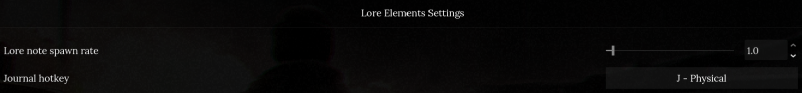
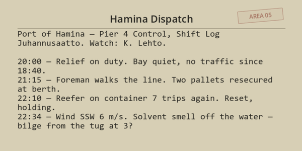
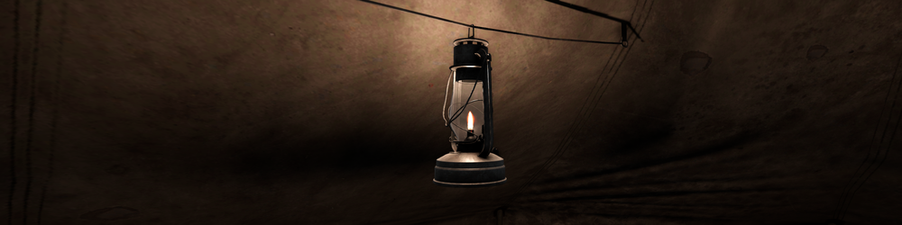

# Lore Elements

Readable notes and environmental storytelling for **Road to Vostok**.

Lore Elements adds discoverable notes, letters, reports, lists, and map fragments to existing loot. Each note can be read in a styled multi-page reader, saved into a persistent journal, and, for selected notes, shown as a discovered pin on the in-game map.

Version `0.2.0` adds original document families, inventory art, reader handwriting
and supported upright placement. The final package is prepared but not yet
published. See [release notes](RELEASE_NOTES.md) and
[save safety and rollback](SAVE_SAFETY.md) before upgrading.

## Requirements

- Road to Vostok; this version targets Steam build `25837777`
- Metro Mod Loader `3.4.2` is the tested baseline. Earlier releases required
  `3.1.1`; this version does not claim full testing on every loader version.
- Mod Configuration Menu is optional but recommended
- Multi Save Slots is not required. Optional checks use the private
  `1.1.14-local-safe.1` build; this is not a claim about other MSS versions.

## Install

1. Close the game and back up the complete userdata directory and exact enabled
   mod archives. Test upgrades on a separate setup and userdata copy first.
2. Obtain the intended `.vmz` package. The prepared package is named
   `rtv_lore_elements-0.2.0.vmz`; published downloads will be linked under Releases.
3. Keep older Lore archives in the backup, outside the active `mods` folder.
   Put the new `.vmz` into the Road to Vostok `mods` folder.
4. Confirm only this Lore version is enabled in Metro and launch through the
   Metro-enabled setup. Do not enable it alongside an RTV-37 test archive.

The public mod ID remains `rtv_lore_elements`; the Metro profile key for this
version is `rtv_lore_elements@0.2.0`. Test archives have a different ID and must
be disabled separately. Preparing this package does not change any installation.

In Developer Mode the loader can also read loose mod folders, but packaged releases should keep `mod.txt` at archive root and the source files under `rtv-lore-elements/`.

## Usage

- Find lore notes through normal loot.
- Right-click a note and choose `Read` to open the reader.
- Use `Prev`, `Next`, `Close`, or Escape/settings to navigate and close notes.
- Press `J` by default to open the journal and re-read discovered notes.
- Some discovered notes add pins to the in-game map.
- Custom document pickups have an extra middle-click upright placement preset.
  Release with `G` near a suitable firm base and backing to prop a document.
  This is physical support, not pinning; cushions and reclined couch backs are
  not guaranteed display surfaces.

## Configuration

With Mod Configuration Menu installed, open the `Lore Elements` page to configure:

- `Lore note spawn rate`: multiplies how often lore notes appear in newly generated loot.
- `Journal hotkey`: changes the key bound to the persistent journal.

## Media

## Links

- Source: <https://github.com/manova/rtv-lore-elements>
- Releases: <https://github.com/manova/rtv-lore-elements/releases>
- Changelog: [CHANGELOG.md](CHANGELOG.md)
- ModWorkshop: <https://modworkshop.net/mod/56568>

## Contributing

Bug reports and small fixes are welcome. Please read [CONTRIBUTING.md](CONTRIBUTING.md) before opening an issue or pull request. Lore/content changes are curated for tone and should start with an issue before a PR.

## License

Code, tooling, manifests, JSON schemas/configuration, and implementation documentation are licensed under the MIT License. See [LICENSE](LICENSE).

Authored lore/content is licensed under Creative Commons Attribution 4.0 International. See [LICENSE-CONTENT](LICENSE-CONTENT). This content license covers `data/notes.json`, user-facing strings in `data/strings/en.json`, and lore note text/name content in `Items/Lore/Notes/*.tres`.

Road to Vostok and original Road to Vostok assets are copyright Plumato Games. Lore Elements does not redistribute copied RtV textures, sounds, or models; it references vanilla game resources at runtime and includes screenshots captured in-game for presentation.

Bundled fonts: Caveat Regular by the Caveat Project Authors ([license](assets/fonts/OFL.txt)), Patrick Hand Regular by Patrick Wagesreiter ([license](assets/fonts/PatrickHand-OFL.txt)), and Nothing You Could Do by Kimberly Geswein ([license](assets/fonts/NothingYouCouldDo-OFL.txt)), each licensed under SIL Open Font License 1.1. See the [Patrick Hand provenance](assets/fonts/PatrickHand-provenance.md) and [pen font provenance](assets/fonts/NothingYouCouldDo-provenance.md).

Original mesh, procedural surface and AI-assisted artwork sources are described
in [asset credits](ASSET_CREDITS.md). Existing license files are unchanged.
